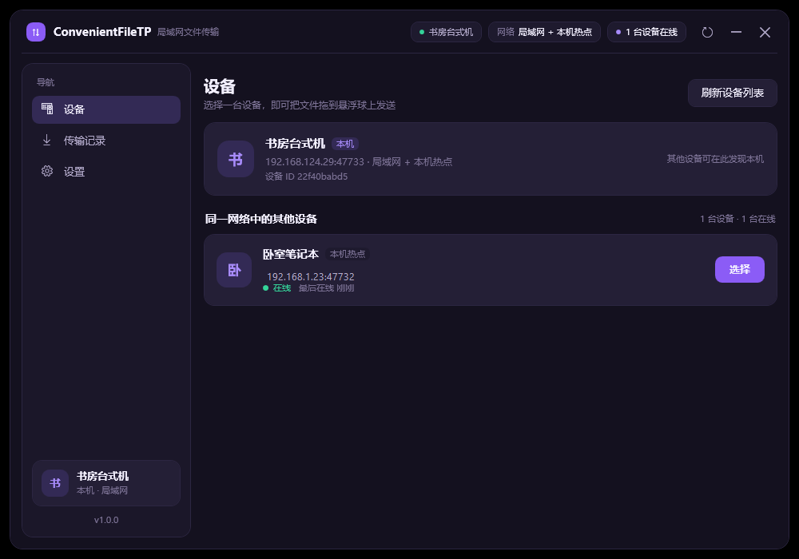
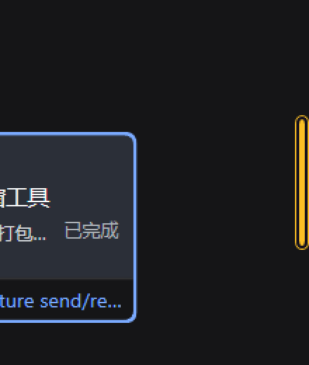
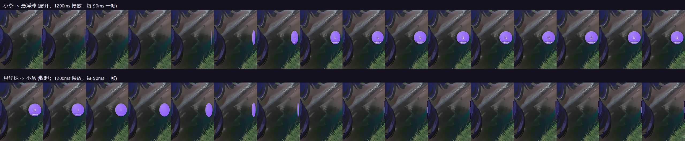
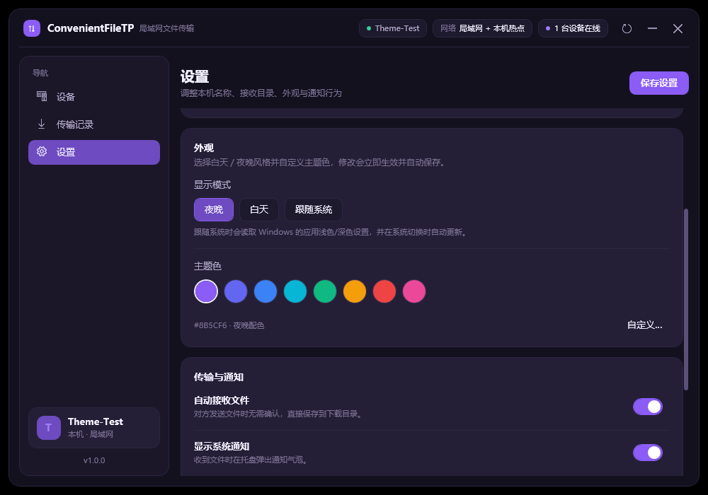
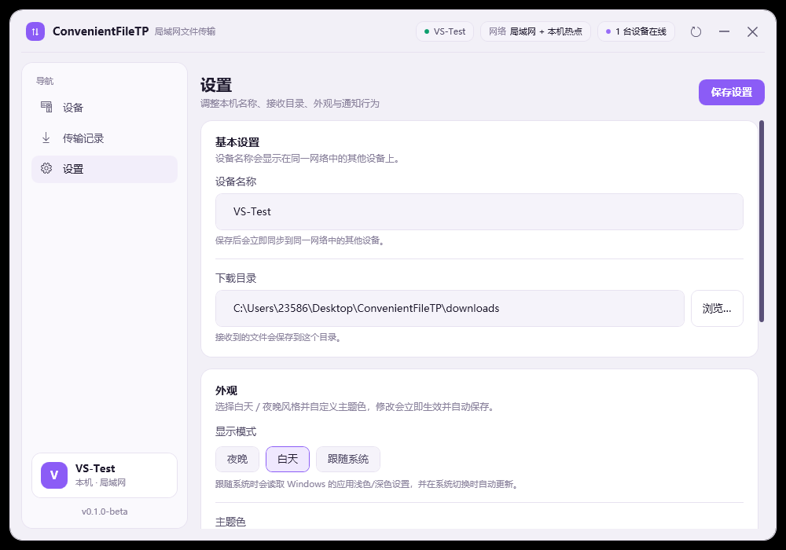
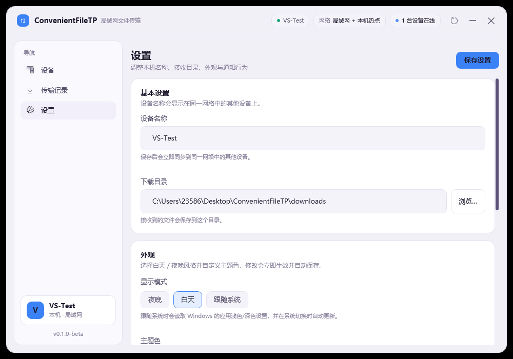
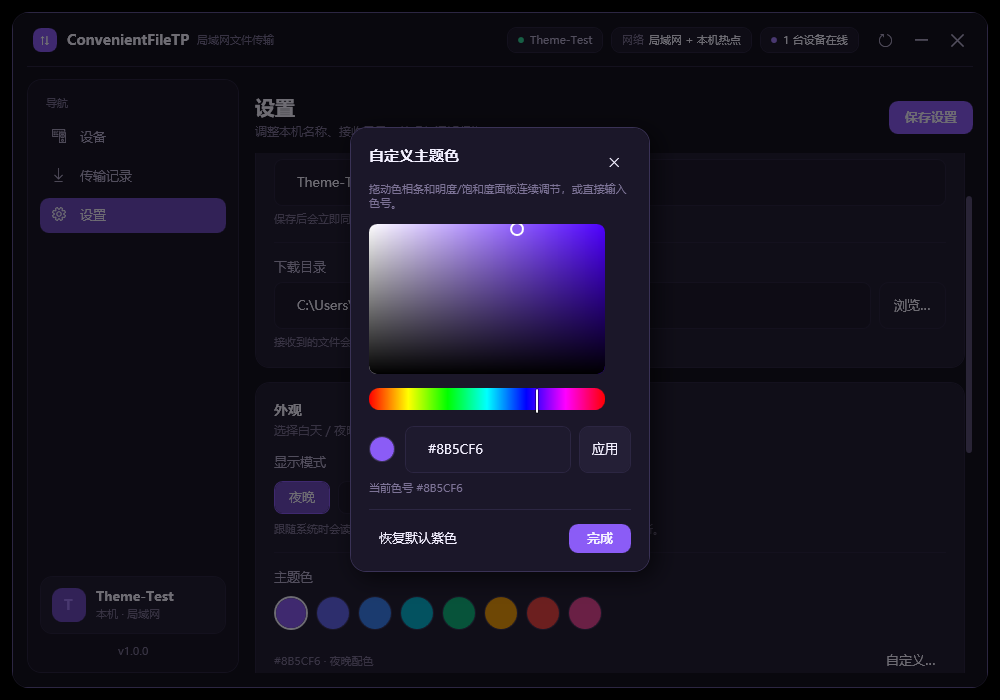
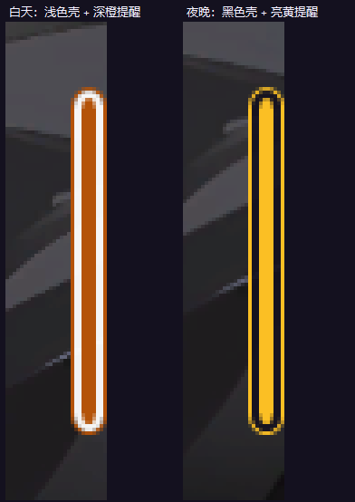
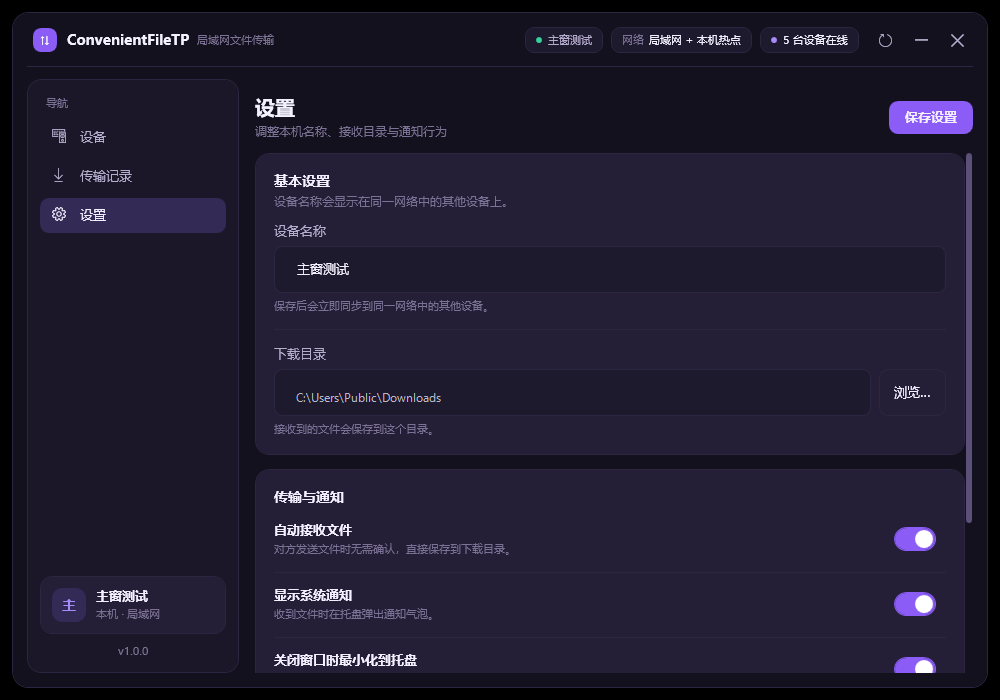
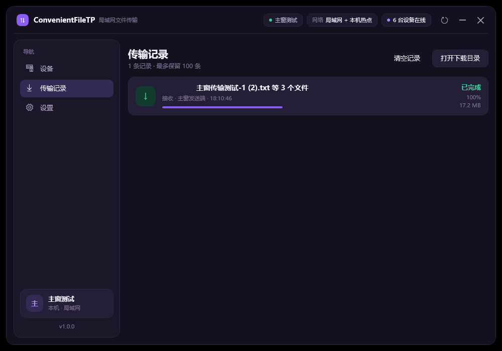

# ConvenientFileTP · 局域网文件传输小工具

一个 Windows 桌面小工具：在同一个局域网（或手机/电脑热点）里自动发现其他运行了本工具的电脑，选中设备后桌面会出现一个**圆形小浮窗**，把文件拖进去就能直接传到对方电脑。接收方会看到实时进度和提醒。

> 纯本地运行，不经过任何服务器；传输只在局域网内进行。当前版本传输内容未加密，请只在可信网络中使用。

## 目录

- [功能一览](#功能一览)
- [界面预览](#界面预览)
- [环境要求](#环境要求)
- [快速开始](#快速开始)
- [悬浮窗使用](#悬浮窗使用)
- [主窗口](#主窗口)
- [托盘与通知](#托盘与通知)
- [主题与外观](#主题与外观)
- [网络模式与连通性](#网络模式与连通性)
- [下载目录与数据位置](#下载目录与数据位置)
- [常见问题](#常见问题)
- [命令行参数](#命令行参数)
- [技术说明：为什么要用 PowerShell 启动](#技术说明为什么要用-powershell-启动)
- [开发、构建与测试](#开发构建与测试)
- [目录结构](#目录结构)

## 功能一览

- **自动发现**：局域网广播/多播发现，同一 Wi-Fi、同一网线、电脑热点、手机热点下都能互相发现；也会显示本机。
- **拖拽即传**：选中设备后桌面出现圆形浮窗，拖文件进去即发送。
- **边缘吸附**：浮窗靠近屏幕边缘自动收起成细条，不挡视线；鼠标悬停展开。
- **三色状态**：
  - 紫色：空闲
  - 红色：正在发送，实时显示进度
  - 绿色：正在接收，实时显示进度
  - 黄色：有收到但还没查看的新文件
- **点击查看**：点击浮窗，只有一个新文件就直接打开它；有多个就打开下载文件夹。
- **多文件/大文件**：一次可拖多个文件，支持大文件；重名自动避让，不会覆盖已有文件。
- **主题自定义**：夜晚 / 白天 / 跟随系统三种显示模式，8 种预设主题色 + 内置取色板（无极调节、支持输入色号）；主窗口、托盘菜单、悬浮窗同步换色。
- **配置持久化**：设备名、下载目录、浮窗位置、主题、开关项都会保存。

## 界面预览

主窗口「设备」页：本机卡片 + 同一网络中已发现的其他设备，点击即可选择。



选中设备后桌面上出现圆形浮窗；靠近屏幕边缘会自动收起成贴边的细条（紫色为常态）：


拖动文件到浮窗即开始发送（发送方红色，显示百分比/速度）：


接收方浮窗变绿并实时显示进度：


接收完成且尚未查看时，细条变黄作为提醒：



浮窗与细条之间是连续的形态过渡（以下为 1200ms 慢放，实际约 240ms）：



主题与外观（夜晚 / 白天 / 自定义主题色，实时生效并自动保存）：

| 夜晚 | 白天 |
| --- | --- |
|  |  |



想要任意色号可以打开内置取色板，拖动饱和度/明度面板与色相条连续调节，或直接输入 16 进制色号：



悬浮窗和细条也会跟随主题；白天用浅色条壳，夜晚用黑色条壳：



其他页面：

| 设置 | 传输记录 |
| --- | --- |
|  |  |

> 说明：红色“发送中”、绿色“接收中”两张图是演示模式下的界面效果截图（进度为演示值）；真实传输时的进度、速度与完成状态已通过 `tools\e2e.ps1` 双实例端到端测试和实机传输验证。

## 环境要求

| 项目 | 要求 |
| --- | --- |
| 系统 | Windows 10 / 11（64 位） |
| 运行时 | .NET Framework 4.8（Windows 10 1903+ / Windows 11 已自带） |
| 启动器 | Windows PowerShell 5.1（系统自带，签名程序）+ cmd 脚本入口 |
| 网络 | 两台电脑在同一个可互通的二层网络（同一路由/热点），且未被 AP 隔离 |
| 权限 | 普通用户即可；开放防火墙端口需要管理员 |

两台电脑都**必须**运行本工具，才能互相发现和传输。

## 快速开始

1. 把整个 `ConvenientFileTP` 文件夹拷贝到两台电脑（路径尽量不含空格；当前路径即可）。
2. 双击 **`启动 ConvenientFileTP.cmd`**（会快速闪过一个命令行窗口，随后只剩托盘图标和主窗口）。
3. 首次启动如果 Windows 防火墙弹窗，请勾选“专用网络”并允许；若没有弹窗但对方发现不了，请按[网络模式与连通性](#网络模式与连通性)手动放行端口。
4. 在另一台电脑上同样启动本工具。
5. 在任意一台电脑的主窗口“设备”页里，找到对方设备，点击它（或“选择”按钮）。
6. 桌面出现圆形浮窗；把文件从资源管理器拖到浮窗上，松手即开始传输。
7. 接收方浮窗会变绿并显示进度，完成后变黄表示“有新文件未查看”；点击浮窗即可打开文件或下载目录。

想要桌面快捷方式：双击 **`创建桌面快捷方式.cmd`**，之后从桌面的 ConvenientFileTP 图标启动（启动时不再闪命令行窗口）。

## 悬浮窗使用

- **拖动**：按住浮窗拖动到任意位置。
- **边缘吸附**：拖到屏幕左/右/上/下边缘附近，松手后自动收成贴边细条（左右为 10×96，上下为 96×10，带描边和进度填充）。
- **悬停展开**：鼠标移到细条上，会平滑展开为圆形球（球与细条之间连续变形，约 240ms）；移开后自动收回。
- **拖文件发送**：从资源管理器选中一个或多个文件，拖到浮窗（球或细条都可以），浮窗高亮时松手。
- **发送中**：浮窗变红，显示百分比和速度；细条中间的状态填充同步增长。
- **接收中**：浮窗变绿，显示接收进度。
- **新文件提醒**：接收成功后变黄；鼠标悬停或点击查看后恢复紫色。
- **点击**：
  - 1 个未查看文件 → 直接打开该文件；
  - 多个未查看文件 → 打开下载目录；
  - 没有未查看文件 → 打开主窗口。
- **右键菜单**：打开下载目录、显示主窗口、隐藏浮窗、退出程序。
- **位置记忆**：浮窗所在的边和上下位置会保存，下次启动恢复。

## 主窗口

- **设备页**：顶部显示本机名称、网络模式、在线设备数；下方是本机卡片和其他设备卡片。点击其他设备即可选中并生成浮窗。
- **传输记录**：显示最近的发送/接收记录（文件名、方向、对方、进度、速度、状态、时间）。接收成功的记录双击可打开文件或下载目录。
- **设置**：
  - 设备名称（修改后立即生效，其他设备会在几秒内看到新名字）
  - 下载目录（默认在项目目录下 `downloads`）
  - 外观（显示模式：夜晚 / 白天 / 跟随系统；主题色：8 种预设 + 内置取色板）
  - 自动接收文件（默认开启；关闭后当前版本会拒绝接收，适合不想被打扰时）
  - 桌面通知（接收完成时托盘气泡）
  - 关闭到托盘（关闭主窗口时是否最小化到托盘）
- 右上角有刷新、最小化、关闭按钮；无系统标题栏，按住顶部区域可拖动窗口。

## 托盘与通知

- 托盘图标常驻；双击打开主窗口。
- 右键菜单：显示主窗口、显示/隐藏悬浮窗、打开下载文件夹、退出。
- 接收完成且主窗口隐藏时，会弹出托盘通知（可在设置中关闭）。
- 退出请用托盘菜单或浮窗右键“退出程序”，直接结束 powershell 进程会跳过清理（不影响文件）。

## 主题与外观

设置页 → 外观，修改后立即生效并自动保存，无需重启。

- **显示模式**：
  - 夜晚：深色背景 + 亮色文字，默认。
  - 白天：浅色背景 + 深色文字。
  - 跟随系统：读取 Windows“应用浅色/深色”设置；在 Windows 里切换主题时，本工具会自动跟随。
- **主题色**：8 种预设（紫、靛蓝、蓝、青、绿、琥珀、红、粉）。点“自定义…”会打开内置取色板：拖动饱和度/明度面板选色、拖动色相条调色相，或直接输入 `#RRGGBB` 色号；拖动过程中界面实时预览，点“应用”保存，也可一键恢复默认紫色。
- 主窗口的按钮、导航选中态、进度条、开关、在线状态点，以及托盘菜单、悬浮球/细条都会同步换色。
- 带主题色背景的文字（设备头像、`选择`/`保存设置`等按钮、`本机`徽标）会根据当前主题色的明暗自动选用黑色或白色文字，浅色和深色主题下都保持可读。
- 悬浮窗的条壳与提醒色会按昼夜适配：白天浅色条壳 + 深橙提醒，夜晚黑色条壳 + 亮黄提醒。
- 配置保存在 `config.json` 的 `ThemeMode`（`system` / `light` / `dark`）与 `AccentColor`（`#RRGGBB`）字段，可手动编辑后重启生效。

## 网络模式与连通性

工具会自动识别三种场景：

1. **局域网**：两台电脑连同一个路由器/Wi-Fi，或同一交换机/网线。最常见。
2. **本机热点**：本机开启了 Windows 移动热点，其他电脑连到本机热点。
3. **热点客户端**：本机连到了别人（电脑或手机）开的热点；工具会把热点拥有者也显示出来。

发现使用 UDP 47731（多播 239.255.77.77 + 子网广播），传输使用 TCP 47732（端口被占用时自动 +1 顺延）。两台电脑不需要在同一网段那么严格，但必须能二层互通、且防火墙放行上述端口。

### 如果互相发现不了

按顺序检查：

1. 两台电脑都启动了工具，且主窗口“设备”页里能看到本机卡片。
2. 两台电脑是否真的在同一个网络（手机热点下常见问题：一台连 Wi-Fi、一台连热点，彼此不通）。
3. **Windows 防火墙**：以管理员身份打开 PowerShell，执行（端口范围覆盖自动顺延）：

   ```powershell
   netsh advfirewall firewall add rule name="ConvenientFileTP UDP" dir=in action=allow protocol=UDP localport=47731
   netsh advfirewall firewall add rule name="ConvenientFileTP TCP" dir=in action=allow protocol=TCP localport=47732-47752
   ```

   也可以直接在“Windows 安全中心 → 防火墙和网络保护 → 允许应用通过防火墙”里允许 Windows PowerShell。

4. 网络配置文件是否为“公用”？公用网络默认更严格，放行端口即可；或把该网络改为“专用”。
5. 路由器/热点是否开启了 **AP 隔离 / 客户端隔离**（常见于公共 Wi-Fi 和部分手机热点设置），开启后设备之间不能互访，需要关闭。
6. 多网卡/虚拟网卡（VPN、VMware、Hyper-V）干扰：工具会枚举所有可用 IPv4 网卡并在每块网卡上收发；如果 VPN 接管了路由，请临时断开 VPN，或让对方设备走同一网卡。
7. 公司/学校网络可能禁止多播和广播，此时工具可能只能看到部分设备；可以尝试用一台电脑开热点给另一台连。

### 热点提示

- Windows 移动热点通常在 `192.168.137.x` 网段；手机热点常见 `192.168.43.x` / `172.20.10.x`。
- 部分无线网卡不支持“同时连 Wi-Fi + 开热点”，此时请用手机热点或路由器。
- 开热点的电脑最好把热点网络设为“专用”，避免防火墙拦截。

## 下载目录与数据位置

- **默认下载目录**：项目目录下的 `downloads`（即 `ConvenientFileTP\downloads`）。可在设置里改成任意目录，会立即生效。
- **配置**：`%APPDATA%\ConvenientFileTP\profiles\<配置名>\config.json`
- **日志**：`%APPDATA%\ConvenientFileTP\profiles\<配置名>\logs\app.log`（超过 2MB 自动轮转为 `app.old.log`）
- 使用默认配置（不传 `--profile`）时，路径为 `%APPDATA%\ConvenientFileTP\config.json` 与 `%APPDATA%\ConvenientFileTP\logs\app.log`。
- 重名文件会自动变成 `文件名 (1).扩展名`、`文件名 (2).扩展名`，不会覆盖已有文件。

## 常见问题

**Q：双击启动没反应？**
A：先确认 `app\ConvenientFileTP.dll` 存在（没有就运行 `tools\build.ps1`）。如果启动失败，会弹出错误对话框；也可以查看上面的日志。仍无反应时，用命令行 `powershell.exe -NoProfile -ExecutionPolicy Bypass -STA -File launcher.ps1 --debug` 启动看输出。不要使用 `.vbs` 启动脚本——Smart App Control 会拦截 VBScript，入口请用 `.cmd` 或桌面快捷方式。

**Q：解压后启动提示 App payload not found？**
A：说明 `app\ConvenientFileTP.dll` 不在 `launcher.ps1` 旁边。常见原因：① 拿到的是旧版本压缩包（仓库 zip 与便携包现已内置运行载荷），请重新下载最新版；若只拿到源码目录，运行 `tools\build.ps1`；② 解压工具把压缩包内的目录分隔符当成了文件名的一部分（旧便携包曾用 `\`，部分工具会生成名字里带反斜杠的单文件），请用 Windows 资源管理器或 7-Zip 解压最新包；③ 安全软件把 DLL 隔离了，请恢复并加入信任。正确结构：`launcher.ps1`、`app\ConvenientFileTP.dll` 等位于同一层目录。

**Q：为什么不用一个 exe？**
A：这台电脑启用了 Windows 的 **智能应用控制（Smart App Control）**，会阻止运行“无法确认发布者”的本地编译 exe。本工具因此编译成 DLL，由系统自带、微软签名的 Windows PowerShell 5.1 在内存中加载运行；不会修改或关闭 Smart App Control，也不需要管理员权限。

**Q：提示“程序已经在运行”？**
A：同一个配置（profile）只允许一个实例。托盘里找一下已有窗口，或退出后重开；需要多开测试时用不同 `--profile`。

**Q：接收方没有弹提示 / 没变黄？**
A：检查设置里“通知”是否为开启、主窗口是否隐藏；黄色状态表示有新文件未查看，点击浮窗即可清除。文件一定在下载目录里。

**Q：传输速度慢？**
A：速度取决于 Wi-Fi/路由器。2.4G Wi-Fi、AP 隔离、老路由是常见瓶颈；有线千兆通常最快。大文件传输时浮窗会持续显示速度。

**Q：能传文件夹吗？**
A：当前版本以文件为单位；可以一次拖多个文件。文件夹请先压缩。

**Q：传输安全吗？**
A：传输仅发生在局域网内，不经过互联网，但没有 TLS 加密；协议自动接收文件。请只在可信的家庭/办公网络中运行，公共网络建议关闭“自动接收”或退出工具。

**Q：杀毒软件/安全软件报警？**
A：因为程序由 PowerShell 加载内存中的 DLL，个别安全软件可能提示“脚本行为”。源码完全公开在本目录 `src\` 下，可用 `tools\build.ps1` 自行构建。

## 命令行参数

一般不需要；调试和自动化测试时使用。

| 参数 | 说明 |
| --- | --- |
| `--profile <名字>` | 使用独立配置/日志目录，便于一台电脑多开测试 |
| `--name <名字>` | 覆盖本机显示名称 |
| `--download-dir <目录>` | 覆盖下载目录 |
| `--root <目录>` | 项目根目录（launcher 自动传入） |
| `--minimized` | 启动后不显示主窗口，只在托盘 |
| `--no-tray` | 不创建托盘图标（测试用） |
| `--debug` | 输出调试日志 |
| `--auto-select <关键字>` | 自动选择名称包含关键字的设备（测试用） |
| `--auto-send <文件1;文件2>` | 自动选择后延时发送这些文件（测试用） |
| `--auto-exit <秒>` | 指定秒数后自动退出（测试用） |

示例（两个实例互相发现并自动传一个文件）：

```powershell
powershell.exe -NoProfile -ExecutionPolicy Bypass -STA -File launcher.ps1 --profile recv --name "接收端" --download-dir "$PWD\.scratch\recv" --debug --auto-exit 90
powershell.exe -NoProfile -ExecutionPolicy Bypass -STA -File launcher.ps1 --profile send --name "发送端" --auto-select "接收端" --auto-send "$PWD\test.bin" --debug --auto-exit 45
```

## 技术说明：为什么要用 PowerShell 启动

本机（以及不少 Win11 设备）启用了 Smart App Control（`HKLM\SYSTEM\CurrentControlSet\Control\CI\Policy` 中 `VerifiedAndReputablePolicyState=1`）。它只允许有信誉签名/微软认可的程序运行；自己用 `dotnet build` 出来的 exe 会在启动时被拦截：

```
System.IO.FileLoadException: 应用程序控制策略已阻止此文件。 (0x800711C7)
```

因此本项目采用：

1. 用 .NET SDK 编译 **.NET Framework 4.8 WPF 类库**（`app\ConvenientFileTP.dll`），不生成 exe；
2. 由系统签名自带的 `powershell.exe`（5.1，STA）读取 DLL 字节，`[Reflection.Assembly]::Load(...)` 在内存中加载；
3. 反射调用 `ConvenientFileTP.AppEntry.Run(args)` 启动 WPF 应用。

这样全程没有一个“本地编译的 exe/DLL 从磁盘被执行”，Smart App Control 不会拦截，也无需关闭系统安全功能。**注意：Smart App Control 也会拦截 `.vbs` 等脚本入口**（提示 “An Application Control policy has blocked this file. Dangerous file extension from the web.”），所以本工具用 `.cmd` 作为双击入口、由 cmd 启动签名 PowerShell；桌面快捷方式则直接指向 `powershell.exe`，启动体验最干净。

## 开发、构建与测试

依赖：.NET SDK（本机 10.0.401 即可，项目目标是 net48）、Windows 10/11。无需联网、无需 NuGet 包。

```powershell
# 构建（输出到 app\ConvenientFileTP.dll）
powershell.exe -NoProfile -ExecutionPolicy Bypass -File tools\build.ps1

# 端到端测试：双实例发现 → 自动选择 → 自动发送 → 校验文件 SHA256
powershell.exe -NoProfile -ExecutionPolicy Bypass -File tools\e2e.ps1

# 网络层测试（由传输引擎自带）
powershell.exe -NoProfile -ExecutionPolicy Bypass -File tools\test-transfer.ps1

# 截图（测试辅助）
powershell.exe -NoProfile -ExecutionPolicy Bypass -File tools\screenshot.ps1 -Path artifacts\shot.png -Delay 2

# 只截某个应用窗口（测试辅助）
powershell.exe -NoProfile -ExecutionPolicy Bypass -File tools\grabwindow.ps1 -TitleLike ConvenientFileTP -Path artifacts\window.png

# 重新生成应用图标：把任意透明底 PNG 放到项目根目录（当前为 图标.png），
# 自动裁掉透明边距并生成 16/20/24/32/40/48/64/96/128/256 多尺寸 assets\app.ico
powershell.exe -NoProfile -ExecutionPolicy Bypass -File tools\make-icon.ps1
```

`assets\app.ico` 同时用于主窗口、任务栏按钮、托盘图标和桌面快捷方式；更换图标后重新运行 `make-icon.ps1` 和 `create-shortcut.ps1` 即可。桌面快捷方式会把图标复制一份到 `%LOCALAPPDATA%\ConvenientFileTP\app.ico` 再引用——因为项目目录被沙箱标记为受限 ACL 后，资源管理器无法直接读取其中的图标文件，否则快捷方式会退化成空白图标。

注意：**所有 `.ps1` 必须保持 ASCII-only**。Windows PowerShell 5.1 会把无 BOM 的 UTF-8 脚本按 ANSI 解析，中文会导致语法错误。中文文案放在 C#/XAML/README 里。

## 目录结构

```
ConvenientFileTP\
├─ 启动 ConvenientFileTP.cmd        # 双击启动入口（cmd → 隐藏的 PowerShell）
├─ 创建桌面快捷方式.cmd             # 生成带图标的桌面快捷方式
├─ 图标.png                          # 应用图标源文件（透明底 PNG）
├─ launcher.ps1                     # PowerShell 内存加载启动器
├─ app\ConvenientFileTP.dll         # 构建产物（运行时唯一需要的程序文件）
├─ src\ConvenientFileTP\            # C# / XAML 源码
│  ├─ App.xaml(.cs) / AppEntry.cs
│  ├─ Core\                         # 协议、发现、传输、配置、日志、模型
│  ├─ UI\                           # 主窗口、悬浮窗、托盘、主题
│  └─ Native\Win32.cs
├─ tools\                           # 构建/测试/截图/图标/打包/快捷方式脚本
│  ├─ build.ps1                     # 编译（带互斥锁，可安全重复运行）
│  ├─ e2e.ps1                       # 双实例端到端测试（含 SHA256 校验）
│  ├─ test-transfer.ps1             # 传输引擎自测
│  ├─ screenshot.ps1 / grabwindow.ps1  # 截图辅助
│  ├─ create-shortcut.ps1 / make-icon.ps1
│  ├─ pack.ps1                      # 生成可拷走的便携 zip 包
│  └─ run.ps1
├─ assets\app.ico                   # 多尺寸应用图标（由 图标.png 生成，窗口/任务栏/托盘/快捷方式共用）
├─ assets\icon-source.png           # 图标源文件副本（make-icon.ps1 可再次使用）
├─ artifacts\                       # 界面截图与端到端测试证据
├─ downloads\                       # 默认接收目录
├─ docs\                            # 内部契约与协议文档
└─ README.md
```

## 版本

当前仍处于**测试阶段**，版本号使用 `0.x.y-beta` 形式，等稳定后再发布 1.0。

- **0.1.0-beta**：首个测试版。包含局域网/热点设备发现与互传、悬浮球/细条拖拽传输、实时进度与三色状态、托盘、设置、主题自定义（含内置取色板）、无障碍与输入稳定性修复；应用图标由 `图标.png` 生成。
  测试版可能仍存在小问题，欢迎反馈；升级前请保留好 `config.json`（位于 `%APPDATA%\ConvenientFileTP\profiles\<profile>`）。
